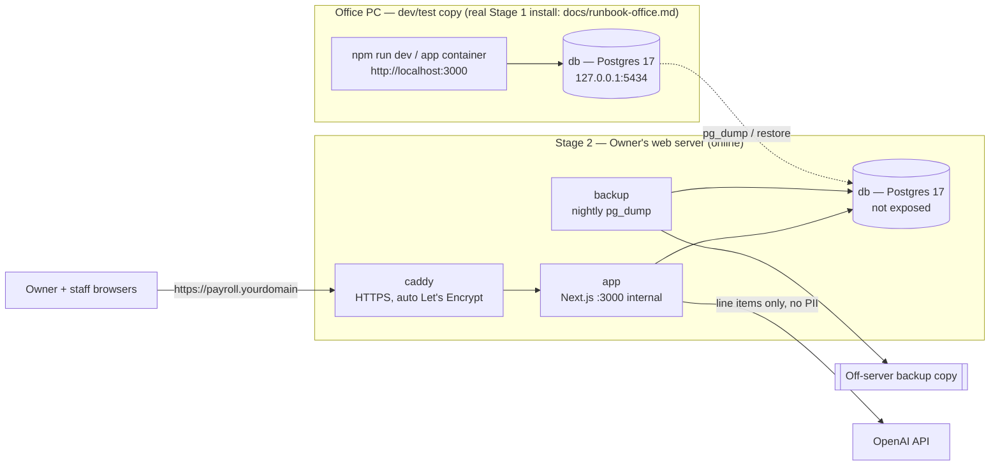
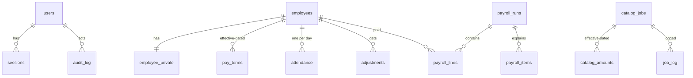

# Architecture — Motonorte HR & Payroll

Status: **v2 — APPROVED by Owner 2026-09-26 (Phase 1 closed)**
Owner agent: system-architect · Updated: 2026-09-26
Inputs: `01-prd.md` v2 (approved), `02-payroll-rules.md` v1 (fixtures approved)

**Deployment update (Owner, 2026-09-27):** Stage 1 = real payroll on the **office PC**, office network only (Caddy `tls internal`, `Caddyfile.office`, `docs/runbook-office.md`); Stage 2 = the Owner's **VPS** (`docs/runbook.md`), same compose, `.env` differs.

**Deployment decision (Owner, 2026-09-26):** build and trial it **locally** on the office PC with its **own Postgres container**, then **push the same Docker Compose setup to the Owner's web server** to go online. Supabase remains an optional later move (§10).

Scale: ~20 employees, 3 users, 52 runs/year. Sized for that; upgrade paths are named, not built.

---

## 1. Components

One `docker-compose.yml` serves both stages. The `prod` profile adds HTTPS and backups on the web server.



| Service | Image | Local (default profile) | Web server (`--profile prod`) |
|---|---|---|---|
| `db` | postgres:17-alpine | `127.0.0.1:5434` | no host port |
| `app` | built from repo (`next build && next start`) | `127.0.0.1:3000` | internal only, `restart: unless-stopped` |
| `caddy` | caddy:2-alpine | — | `:80`/`:443`, automatic Let's Encrypt cert for the domain |
| `backup` | postgres:17-alpine + cron loop | — | nightly `pg_dump` → `./backups`, copied off-server |

Existing local containers (`motonorte-hr-db`, `motonorte-people-*`, `web-postgres-1`) are **not touched**.

- **Dev:** `docker compose up db` + `npm run dev` on the host. **Local trial of the real build:** `docker compose up`. **Web server:** `docker compose --profile prod up -d`.
- **Dev/test copy** (Desktop folder) is localhost only. The **real office install** (`docs/runbook-office.md`) serves the office network over HTTPS with Caddy's private CA (`Caddyfile.office`).
- **No background jobs besides backup.** Payroll is generated on demand.

## 2. Code layout

```
app/                    # routes as before: employees, catalog, week/[start], payroll/[runId], reports, dashboard, settings, login
lib/
  payroll/              # PURE engine — no imports from db, next, or fetch
    engine.ts  thirteenth.ts  types.ts  engine.test.ts (runs all fixtures)
  db/
    client.ts           # postgres driver; withUser(userId, fn) — the ONLY way to query
    queries/*.ts        # typed SQL per feature
    loadPeriodInput.ts
  auth/
    password.ts         # scrypt hash/verify (node:crypto)
    session.ts          # create/validate/revoke sessions, cookie handling
    requireRole.ts
  ai/explain.ts
db/
  migrations/NNN_*.sql  # plain SQL, Supabase-compatible
  seed.sql              # fake data for dev only
  migrate.ts            # applies pending migrations, records in schema_migrations
scripts/
  create-user.ts        # CLI: create owner/staff account (no public sign-up)
fixtures/payroll/
docker-compose.yml  Caddyfile  Dockerfile  .env.example
```

## 3. Auth & authorization

No Supabase Auth locally, so the app owns authentication (ADR-009):

- **Accounts:** `users(id, email, password_hash, role, active)` with `role ∈ {staff, owner}`. Created only by `npm run create-user` (first Owner) and by the Owner from a settings page afterward. No public sign-up.
- **Passwords:** `crypto.scrypt` (Node stdlib), per-user random salt, constant-time compare. Minimum 12 characters.
- **Sessions:** random 32-byte token in an `HttpOnly; Secure; SameSite=Lax` cookie; only its SHA-256 hash is stored in `sessions(token_hash, user_id, expires_at)`. 12-hour expiry, sliding. Logout deletes the row.
- **Login throttling:** `login_attempts` table; 5 failures per email per 15 min → locked for 15 min.
- **CSRF:** Next.js Server Actions check the Origin header; Route Handlers that change data accept POST only and check Origin.

**Authorization stays in the database (RLS)** so it survives the move to Supabase:

- The app connects as `app_user`, a **non-owner** role; tables are owned by `app_owner` (migrations only) and have `FORCE ROW LEVEL SECURITY`.
- `withUser(userId, fn)` opens a transaction and runs `select set_config('app.user_id', $1, true)` first. Every query runs inside it.
- `app_role()` (SQL, `STABLE`) reads `current_setting('app.user_id', true)` → looks up `users.role`. **All policies call `app_role()`**; none reads the setting directly.
- On Supabase later, only `app_role()` changes (to read `auth.uid()`); policies stay the same.

Policy matrix (data-architect writes the SQL):

| Table group | staff | owner |
|---|---|---|
| employees, employee_private | select/insert/update | all |
| pay_terms | select, insert as *proposed* | all, approve |
| catalog_*, settings, holidays | select | all |
| attendance, job_log, adjustments | all, unlocked periods only | all, unlocked periods only |
| payroll_runs / lines / items | select, generate draft, submit | all + approve/lock |
| users | select self | all |
| sessions, login_attempts | app-internal via SECURITY DEFINER functions only | same |
| audit_log | select | select |

Only `owner` can call `lock_run()`; the function checks `app_role()` itself.

## 4. Pay engine

Unchanged from v1:
- `computeWeek(PeriodInput) → PeriodResult | PayrollError`, pure, deterministic (PR-070).
- Integer centavos; multipliers as integer hundredths (ADR-003). Largest intermediate ≈ 1.1 × 10¹² < 9 × 10¹⁵.
- Every item has provenance `{ emp, date, kind, amount, rule_id, source }` for drill-down.
- `engine.test.ts` runs every case in `fixtures/payroll/*.json`; any 1-centavo difference fails CI.

## 5. Payroll run lifecycle

`draft → submitted → locked` (owner can send `submitted` back to `draft`).
- **Generate:** `loadPeriodInput` → `computeWeek` → errors shown to the user (e.g. `MISSING_ATTENDANCE S001 2026-10-08`) or `save_draft(period_start, result jsonb)` which, in **one transaction**, replaces the run's lines/items and snapshots settings + catalog amounts.
- **Lock:** `lock_run(run_id)`, owner-only; writes `carry_out` into the next period's `carried_in`.
- **Immutability via DB triggers** (ADR-008) on locked runs and on attendance/job_log/adjustments in locked periods.

## 6. Data model (outline — data-architect owns the SQL)

As v1, plus auth tables:

| Table | Key columns |
|---|---|
| users | id uuid, email unique, password_hash, role, active, created_at |
| sessions | token_hash (pk), user_id, expires_at, created_at, ip, user_agent |
| login_attempts | email, at, success |
| employees | id, code unique, full_name, position_current, rest_day, hire_date, end_date, active |
| employee_private | employee_id, tin, sss_no, philhealth_no, pagibig_no, bank_name, bank_account_no |
| pay_terms | employee_id, effective_from, position, daily_rate_centavos, status, approved_by |
| catalog_jobs / catalog_amounts | code, name, active / job_id, effective_from, amount_centavos |
| settings | key, value_hundredths, effective_from |
| holidays | date, name, type |
| attendance | employee_id, date, status (F/H/A/R), ot_minutes · unique(employee_id, date) |
| job_log | date, job_id, qty, work_order_ref, plate_no, created_by |
| adjustments | employee_id, period_start, kind, type, amount_centavos, reason |
| payroll_runs | id, period_start unique, payday, status, snapshot jsonb, submitted_by/at, locked_by/at |
| payroll_lines | run_id, employee_id, basic, base, ot, incentive, allowances, deductions, carried_in, gross, net, carry_out |
| payroll_items | run_id, employee_id, date, kind, amount, rule_id, source jsonb |
| audit_log | id, at, actor, table_name, row_id, action, old jsonb, new jsonb — append-only |
| schema_migrations | version, applied_at |

UUID primary keys (`gen_random_uuid()`, built into PG13+). Money `bigint` centavos. Dates `date` in Asia/Manila. No Supabase-specific extensions, so the schema restores cleanly into Supabase.

## 7. OpenAI usage

Unchanged: explain-payslip (Should), report Q&A and anomaly flags (Could). Sends only line items, employee code and first name, and rule text. Never gov't IDs, bank data, or other employees' pay. Server-side check that every peso figure in the answer exists in the items, otherwise show the plain breakdown. Needs internet; the rest of the app works offline.

## 8. Other components

- **Payslips:** print-optimized HTML, one page per employee, browser "Save as PDF" (ADR-004).
- **Bank file:** CSV in RCBC Corporate bulk-credit layout from a locked run (blocked on template, OQ-18a). Download logged to audit_log.
- **Reports/dashboard:** SQL views over locked runs grouped by payday month/year (PR-011); CSV export.
- **Audit:** generic trigger → `audit_log` with actor = `app.user_id`; UPDATE/DELETE revoked; `employee_private` values masked (last 4 digits).

## 9. Operations

**Stage 1 — office PC, office network only.** Full procedure: `docs/runbook-office.md`. Essentials:
- `db` and `app` bound to `127.0.0.1` only; strong random passwords in `.env` (gitignored).
- Use seed/fake data for development. If real employee data is entered for a trial or parallel run, BitLocker should be on and the Windows account password-protected, because the DB then holds gov't IDs and bank accounts.

**Stage 2 — web server (online).** Required before the first real payroll:

| # | Requirement | How |
|---|---|---|
| OPS-1 | HTTPS with a real certificate | Domain/subdomain (e.g. `payroll.yourdomain`) → server IP; Caddy obtains Let's Encrypt automatically |
| OPS-2 | Only 80/443 open | Server firewall (ufw or provider firewall) allows 22 (SSH, key-only), 80, 443; Postgres has no public port |
| OPS-3 | Auto-restart | Docker service enabled at boot; compose `restart: unless-stopped` |
| OPS-4 | Nightly backups, off the server | `backup` service: `pg_dump` at 23:00 PHT → `./backups/motonorte-YYYYMMDD.sql.gz`, keep 30 daily + 12 monthly, then copied off-server (object storage or pulled to the office PC) |
| OPS-5 | Restore tested | Restore last night's dump into a scratch DB and run a check query before go-live, then monthly |
| OPS-6 | Secrets | `.env` on server only (chmod 600), never in git; different passwords from local |
| OPS-7 | Updates | OS security updates on; `docker compose pull && up -d` for base images monthly |
| OPS-8 | Access hardening | Optional: restrict the site to the office IP / VPN if staff only use it from the shop |

**Server requirements (check before Phase 4):** a Linux VPS or dedicated server where you can run Docker (1 vCPU / 1–2 GB RAM is enough for 20 employees). Shared hosting that only supports PHP/cPanel **cannot** run this stack; see OQ-20.

## 10. Going online (Stage 1 → Stage 2), and optional Supabase later

**To your web server:**
1. `git clone` the repo on the server; create `.env` with production secrets and `DOMAIN=payroll.yourdomain`.
2. `docker compose --profile prod up -d` (migrations run on start).
3. Either start fresh (`npm run create-user` for the Owner) **or** carry over trial data: `pg_dump` local → `psql` restore on the server.
4. Verify OPS-1..8, then run the first live week **in parallel** with the old process.

**To Supabase (optional, later):** restore the dump into a Supabase project and point `DATABASE_URL` at it. RLS, triggers and `app_role()` work unchanged, and our own auth keeps working. Switching to Supabase Auth is a separate, optional step (re-invite 3 users, change `app_role()` to read `auth.uid()`).

## 11. Story → component map

| Story | Component |
|---|---|
| US-001–003 | `app/employees`, employees, employee_private, pay_terms |
| US-010 | `app/catalog`, catalog tables |
| US-020, 021 | `app/week/[start]`, attendance, job_log |
| US-022 (Should) | CSV import Server Action |
| US-023 | lock-guard triggers |
| US-030–033 | `lib/payroll`, `app/payroll/[runId]`, save_draft / lock_run |
| US-034 | payslip print view |
| US-035 | bank-file Route Handler |
| US-040, 041 | report views + CSV |
| US-050 | dashboard views |
| US-051–053 | `lib/ai` |
| US-060 | audit trigger |
| US-061 | `lib/auth`, users/sessions, `app_role()`, RLS |

## 12. ADRs

| ID | Decision | Why | Consequence |
|---|---|---|---|
| ADR-001 | No separate backend; the Next.js server is the backend | 3 users | One container for the app |
| ADR-002 | Pay engine in TypeScript, persisted via one SQL function | Fixture tests + shared types | JSON passed to `save_draft` |
| ADR-003 | Integer centavos; multipliers as integer hundredths | Exact rounding | Settings UI converts 1.25 ↔ 125 |
| ADR-004 | Payslips via print CSS | No dependency | Emailing PDFs needs a library later |
| ADR-005 | Role stored in `users` table, read by `app_role()` | Single source for RLS | Owner changes roles |
| ADR-006 | No public sign-up | Internal tool | `create-user` script bootstraps the Owner |
| ADR-007 | Same Docker Compose stack locally and on the Owner's web server; Supabase optional later | Owner decision; local == prod avoids surprises at launch | Web server must run Docker (OQ-20) |
| ADR-008 | Locks enforced by DB triggers | App bugs can't edit locked pay | Corrections via adjustments only |
| ADR-009 | Own auth with Node `crypto.scrypt` + DB sessions (no auth library) | No Supabase Auth locally; 3 users; stdlib covers hashing | Security-auditor reviews `lib/auth` closely; re-evaluate if SSO/MFA needed |
| ADR-010 | RLS via `app.user_id` transaction setting, app connects as non-owner role | Keeps authorization in the DB and portable to Supabase | Every query must go through `withUser()` — reviewer checks |
| ADR-011 | `postgres` npm driver + raw SQL, no ORM | Small schema, RLS/trigger-heavy design | Types written by hand per query |
| ADR-012 | Plain SQL migrations + ~30-line runner | Supabase-compatible files, no tool lock-in | Upgrade to dbmate if migrations get complex |

## Hand-off checklist

- [x] Every PRD story maps to a component (§11)
- [x] RLS strategy per role defined (§3)
- [x] Pay engine is pure (§4)
- [x] OpenAI data flow documented, no bank/tax IDs sent (§7)
- [x] Local + web-server operations requirements listed (§9)
- [ ] OQ-20 (web server type) answered — needed before Phase 4, not before Phase 2
- [x] Human approval → Phase 2 (Owner, 2026-09-26)

---

## Data Model (added by data-architect, 2026-09-26)

Source of truth: `db/migrations/001_init.sql` · checks: `db/tests/verify.sql` (49 checks, all passing on Postgres 17).



**Deviations from §3–§6 (deliberate, simpler):**
1. **RLS is `ENABLE`, not `FORCE`.** The app never connects as the owner, and the `SECURITY DEFINER` payroll/auth functions need to run as the owner to write `payroll_*`, `sessions` and `login_attempts`, which have no write grants for `app_user`.
2. **`carried_in` is derived, not written.** `carried_in_for(period_start)` reads `carry_out` from the latest locked run before the period, so `lock_run` doesn't touch the next week.
3. **Stale-draft detection** uses `payroll_runs.input_hash`: the server hashes the normalized `PeriodInput`, and `lock_run(run, expected_hash)` refuses a mismatch (`RUN_STALE`). Weeks must be locked in order (`EARLIER_RUN_UNLOCKED`).
4. `users.password_hash` is write-only for `app_user` (column grants); login reads it only via `auth_login_lookup()`.
5. `create-user` bootstraps the first Owner using the **owner** DB connection (no session exists yet); everything else uses `app_user`.
