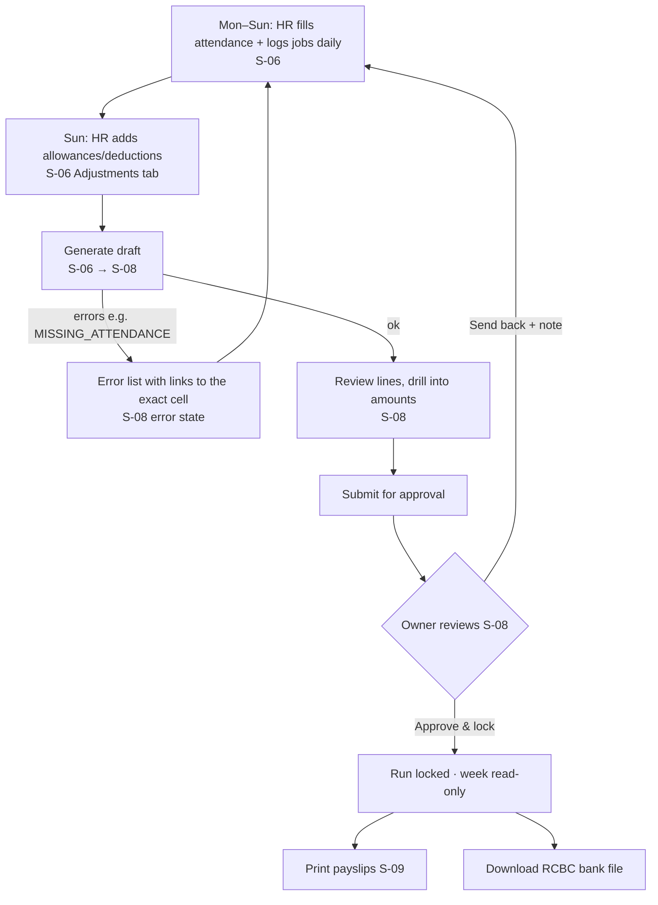
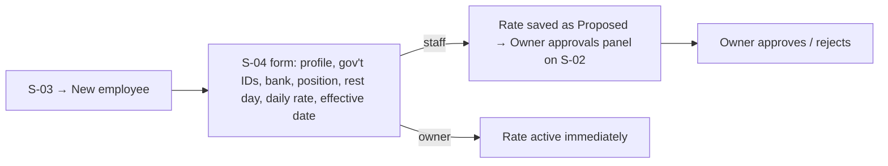
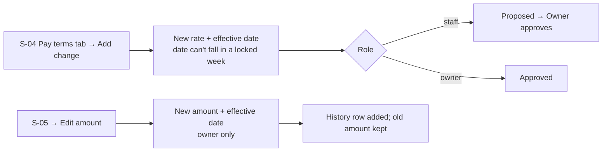

# UX Spec — Motonorte HR & Payroll

Status: **v1** · Owner agent: ux-designer · Date: 2026-09-26
Inputs: `01-prd.md` v2, `03-architecture.md` v2 (both approved)

Principles: data-dense tables over cards · every peso figure clickable to its source ("why is this number this?") · keyboard-first data entry · native elements (`<table>`, `<select>`, `<dialog>`, `<input type="date">`) before libraries · WCAG AA · desktop-first (≥1280 px), usable down to 1024 px. Phone layout is out of scope for MVP, apart from read-only dashboard/payslip views that simply stack.

---

## 1. Screen inventory

| ID | Route | Screen | Staff | Owner | Stories |
|---|---|---|---|---|---|
| S-01 | `/login` | Sign in | ✅ | ✅ | US-061 |
| S-02 | `/` | Dashboard | ✅ | ✅ (+ approvals panel) | US-050 |
| S-03 | `/employees` | Employee list | ✅ | ✅ | US-001, 003 |
| S-04 | `/employees/[id]` · `/employees/new` | Employee detail / form | ✅ (rate = propose) | ✅ | US-001–003 |
| S-05 | `/catalog` | Incentive job catalog | view | edit | US-010 |
| S-06 | `/week/[start]` | Week workspace (attendance · jobs · adjustments) | ✅ | ✅ | US-020, 021, 023, 033 |
| S-07 | `/payroll` | Payroll runs list | ✅ | ✅ | US-030 |
| S-08 | `/payroll/[runId]` | Run review + drill-down | ✅ (submit) | ✅ (approve/lock, send back) | US-030–032, 035 |
| S-09 | `/payroll/[runId]/payslips` | Payslips print view | ✅ locked only | ✅ locked only | US-034 |
| S-10 | `/reports` | Monthly summary · 13th month | ✅ | ✅ | US-040, 041 |
| S-11 | `/settings` | Pay settings · holidays · users | view | edit | PR-030, US-061 |
| S-12 | `/audit` | Audit log | ✅ | ✅ | US-060 |

**Global layout:** left sidebar nav (Dashboard, This week, Employees, Payroll, Catalog, Reports, Settings, Audit), top bar with the current user's name and role badge, plus Sign out. Current week shortcut: "This week → Oct 5–11".

## 2. User flows

### F-1 Weekly payroll cycle (the core loop)


### F-2 Onboard employee


### F-3 Change daily rate or incentive amount


### F-4 Clawback / cash advance
S-06 (week of the payday it should hit) → Adjustments tab → Add → kind = Deduction, type = Clawback, amount, reason (required), optional WO ref → appears on the draft as a deduction line. If net < 0, the Carry-out column shows the balance and next week's draft shows it as Carried in.

### F-5 Owner approval
S-02 approvals panel lists: runs awaiting approval · proposed rate changes. Each links to its screen. Approve & lock requires a confirm `<dialog>` that restates the total net and headcount: "Lock payroll Oct 5–11? 20 employees · Net ₱92,450.00. This cannot be undone."

## 3. Screen specs

### S-01 Sign in
- Centered card: Email, Password (`autocomplete` set), Sign in button, error region (`role="alert"`).
- Errors: "Email or password is incorrect" (never say which). Throttled: "Too many attempts. Try again in 15 minutes."
- No sign-up and no "forgot password" link in MVP; the Owner resets passwords in S-11.

### S-02 Dashboard
- **Header row:** week selector (defaults to the latest locked week) and "This week" status chip (Open / Draft / Submitted / Locked).
- **KPI tiles (4):** Payroll net (week) · Incentives paid (week) · Jobs logged (week) · Attendance rate (week). Each shows the change vs. the previous week.
- **Chart 1:** 12-week bar chart of net payroll, split base / OT / incentives. Build it as an SVG in a server component; no chart library unless the dataviz task justifies one.
- **Table:** incentives per mechanic this week (mechanic, full days, incentive ₱, share of pool %).
- **Table:** top job types this week (job, qty, ₱).
- **Owner only: Approvals panel** at the top when non-empty.
- Empty: "No locked payroll yet. Start with This week →". Loading: skeleton tiles. Error: inline banner with retry.

### S-03 Employee list
- Toolbar: search (name/code), filter Position (All / Staff / Mechanic / Technician), toggle "Show inactive", button **New employee**.
- Table columns: Code · Name · Position · Rest day · Daily rate · Status (Active / Inactive) · Pending change badge.
- Row click → S-04. Sort by code by default.
- Empty: "No employees yet. Add your first employee." with a button.

### S-04 Employee detail / form
Tabs: **Profile · Government & bank · Pay terms**.
- **Profile:** Code (auto-suggested, e.g. M004, editable until first payroll), Full name, Position, Rest day (`<select>` Mon–Sun), Hire date, End date (only when deactivating), Active.
- **Government & bank:** TIN, SSS, PhilHealth, Pag-IBIG, Bank name (default RCBC), Account no. Values are masked (`•••• 1234`) with a "Show" toggle per field; each reveal is logged to audit.
- **Pay terms:** history table (Effective from · Position · Daily rate · Status · By). Button **Add change** opens an inline form (rate, position, effective date). Staff see "Will be sent to the Owner for approval".
- Validation (server, shown per field): required fields; rate > 0; effective date not inside a locked week; code unique.
- Deactivate: button → `<dialog>` asking for an end date → sets inactive. No delete.

### S-05 Incentive catalog
- Table: Code · Job name · Current amount · Effective since · Active · History (expand row shows past amounts).
- Owner: **Add job** (code, name, amount, effective from) · **Change amount** (new amount + effective date) · Activate/Deactivate. Staff: read-only.
- Amount input in pesos with 2 decimals; converted server-side to centavos.
- Empty (owner): "Add the jobs that earn incentives, e.g. Throttle Body Cleaning ₱150."

### S-06 Week workspace — the most-used screen
Header: `‹ Prev week` **Oct 5 – 11, 2026 · Payday Sun Oct 11** `Next week ›` · status chip · primary button **Generate payroll draft** (disabled with a reason tooltip when locked).
Locked banner (when locked): "This week is locked. Changes go in as adjustments on a later week." All inputs are read-only.

**Tab 1: Attendance grid**
- Rows: active employees (grouped Mechanics · Technicians · Staff). Columns: Mon…Sun with date, plus Total days.
- Each cell: `<select>` with `— / F Full / H Half / A Absent / R Rest` and a small OT hours input (`type="number" step="0.25" min="0"`, shown only when F). Hours are converted to minutes server-side.
- The rest-day column for each employee is shaded, and `R` is only offered there.
- Holidays: column header shows a holiday badge with its name.
- Empty cells show `—` and are flagged amber. **No silent defaults.** The button **Fill empty cells** (F on work days, R on rest day) fills only cells that are still empty, and only when clicked.
- Days before hire / after end date are greyed out with `-`.
- Keyboard: arrow keys move between cells; typing F/H/A/R sets the value. Saves per cell (Server Action) with a saved ✓ / error ✕ indicator.
- Footer: per-day count of full-day mechanics (feeds the pool).

**Tab 2: Incentive jobs**
- Day picker (Mon…Sun chips showing each day's pool ₱).
- For the selected day: table Job · Qty · WO ref · Plate · Logged by · remove. **Add job** row at the bottom: job `<select>` (active jobs, with amount shown), qty (default 1), WO ref, plate; Enter adds.
- Day summary box, computed server-side: "Pool ₱600.00 ÷ 3 full-day mechanics (M001, M002, M003) = ₱200.00 each". If 0 mechanics: red "No full-day mechanic on this day. Payroll can't be generated until attendance is fixed."

**Tab 3: Adjustments**
- Table: Employee · Type (Cash advance, Clawback, Correction, Other) · Amount · Reason · WO ref · By. Deductions only — allowances come from the employee's daily allowance (PR-062, OQ-20).
- Add form: all fields required except WO ref. The carried-in balance from the previous week is shown read-only at the top ("M001 carried in: ₱150.00").

States: loading = table skeleton; save error = cell outlined red with message; server error = banner.

### S-07 Payroll runs list
- Table: Week (Oct 5–11) · Payday · Status · Employees · Net total · Submitted by/at · Locked by/at. Newest first.
- Click → S-08. Empty: "No payroll runs yet. Go to This week to generate one."

### S-08 Run review
Header: week + status chip + actions by status/role:

| Status | Staff | Owner |
|---|---|---|
| draft | Regenerate · Submit for approval | Regenerate · Submit for approval (locking requires a submitted run, §5) |
| submitted | (view only) | Send back (note required) · Approve & lock |
| locked | Payslips · Bank file (RCBC) | Payslips · Bank file (RCBC) |

- **Summary strip:** Employees · Gross · Deductions · Net · Incentive pool total · Carry-out total.
- **Lines table** (sticky header, totals row, `tabular-nums`, right-aligned money): Code · Name · Position · Days (F/H) · Base · OT · Incentive · Allowances · Deductions · Carried in · Gross · **Net** · Carry out.
- **Drill-down:** every money cell is a button that opens a `<dialog>` listing the items behind it: date, description, amount, rule ID (e.g. `PR-053`) and source. Example for an incentive: "Tue Oct 6 — Pool ₱600.00 (2× Throttle Body Cleaning ₱150, 3× Chain Clean ₱100) ÷ 3 mechanics (M001, M002, M003) = ₱200.00 · PR-051, PR-053". Under Should (US-051): an **Explain** button in the dialog that falls back to this itemized text.
- **Error state (generate failed):** replaces the table with a list, one row per error: "Missing attendance: S001 on Thu Oct 8 → Fix" (link goes to S-06 with that cell focused). Codes: `MISSING_ATTENDANCE`, `NO_ELIGIBLE_MECHANIC`, `INVALID_OT`.
- **Stale draft:** if source data changed after the draft was generated, show a banner "Attendance or jobs changed since this draft was generated. Regenerate." Submit stays disabled until then.
- Confirm dialogs: Submit, Send back (textarea), Approve & lock (restates headcount and net; see F-5).

### S-09 Payslips print view
- Screen: toolbar with **Print / Save as PDF** plus an employee filter. Print CSS hides everything else.
- One A4 page per employee (`break-after: page`). Header: company name · "Payslip" · week · payday · employee code/name/position.
- Sections: **Earnings** (Base: n days × ₱rate; OT: h hrs; Incentives: one row per day with the jobs in that day's pool and the share) · **Allowances** · **Deductions** (incl. carried in) · **Net pay** (large) · Carry-out note if > 0.
- Footer: "Generated from locked run on <date>". No signature line in MVP.

### S-10 Reports
- **Monthly summary:** month picker → table per employee: Base, OT, Incentives, Allowances, Deductions, Net, Gross compensation (for the accountant). Weeks are attributed by payday month (PR-011). **Export CSV**.
- **13th month:** year picker → table per employee: Total basic · 13th month (÷12) · note "Incentives, OT and allowances excluded". **Export CSV**. (Should)

### S-11 Settings (owner edits, staff view)
- **Pay settings:** Rest-day worked ×, Holiday worked ×, Holiday unworked ×, OT ×. Numeric inputs with 2 decimals and an effective-from date. The legal note from the PRD is shown beside them.
- **Holidays:** year selector; table Date · Name · Type (Regular / Special); add/remove (not allowed in locked weeks).
- **Users:** table Email · Role · Active · Last sign-in; Add user (email, role, temporary password); Reset password; Deactivate.

### S-12 Audit log
- Filters: date range, table, user. Table: When · Who · What (table + action) · Record · Changes (expand: before/after JSON rendered as a two-column diff; sensitive fields masked).

## 4. States checklist

| Screen | Empty | Loading | Error |
|---|---|---|---|
| S-01 | — | button spinner | alert region |
| S-02 | "No locked payroll yet" + link | skeleton tiles | banner + retry |
| S-03 | "Add your first employee" | table skeleton | banner |
| S-04 | new-employee form | field skeleton | per-field + banner |
| S-05 | owner prompt / staff "No jobs defined yet" | table skeleton | banner |
| S-06 | empty cells amber + "Fill empty cells" | grid skeleton | cell-level ✕ + banner |
| S-07 | "No payroll runs yet" + link | table skeleton | banner |
| S-08 | n/a (a run always has lines or errors) | table skeleton | generate-error list; stale banner |
| S-09 | "Run not locked" (blocked) | — | banner |
| S-10 | "No locked runs in this period" | table skeleton | banner |
| S-11 | "No holidays for this year" | skeleton | per-field |
| S-12 | "No activity in this range" | table skeleton | banner |

Destructive or irreversible actions (lock, send back, deactivate employee, deactivate user, remove job log row) always use a `<dialog>` confirm that states the consequence.

## 5. Formatting

- Money: `₱12,345.67`, `font-variant-numeric: tabular-nums`, right-aligned; negative shown as `−₱150.00` in the danger color **and** with the minus sign.
- Dates: `Mon Oct 5` in grids, `Oct 5, 2026` elsewhere; weeks `Oct 5 – 11, 2026`. All in Asia/Manila.
- Status: letter + color, never color alone (F green, H amber, A grey, R blue, `—` amber outline).
- Employee reference: `M001 · Juan D.` in dense tables.

## 6. Design tokens (Tailwind v4 `@theme`)

Neutral palette with one accent; swap `--color-brand-*` once Motonorte brand colors are provided.

```css
@theme {
  --color-brand-600: #c2410c;   /* accent: primary buttons, active nav */
  --color-brand-700: #9a3412;   /* hover */
  --color-brand-50:  #fff7ed;   /* selected row, active chip bg */
  --color-surface:   #ffffff;
  --color-surface-2: #f8fafc;   /* page bg, table header */
  --color-border:    #e2e8f0;
  --color-text:      #0f172a;
  --color-text-muted:#475569;   /* ≥ 4.5:1 on white */
  --color-success:   #15803d;
  --color-warning:   #b45309;
  --color-danger:    #b91c1c;
  --color-info:      #1d4ed8;
  --font-sans: "Inter", ui-sans-serif, system-ui, sans-serif;
  --text-xs: 0.75rem; --text-sm: 0.875rem; --text-base: 1rem; --text-lg: 1.125rem; --text-2xl: 1.5rem;
  --radius-md: 0.375rem;
}
```
- Spacing: Tailwind default 4 px scale; table rows `py-2 px-3`; page padding `p-6`.
- Focus: `focus-visible:outline-2 outline-offset-2 outline-brand-600` on every interactive element.
- Dark mode: not in MVP.

## 7. Accessibility

- Every input has a visible `<label>` (grid cells use `aria-label="S001 Thu Oct 8 status"`).
- Tables use `<th scope>`; money cells that open drill-downs are `<button>`s with an accessible name ("Incentive for M001: ₱400.00, show details").
- `<dialog>` for modals (focus trap and Esc built in); focus returns to the trigger on close.
- Status messages (saved, errors) announced via `aria-live="polite"`; blocking errors via `role="alert"`.
- Contrast AA verified for the token pairs above.

## Hand-off checklist

- [x] Every Must story has a screen + flow (§1 map; F-1…F-5)
- [x] Every screen has empty/loading/error states (§4)
- [x] Every pay figure has a drill-down (S-08 dialog, S-09 itemized payslip)
- [x] Role visibility matches PRD matrix (§1, S-08 action table)
